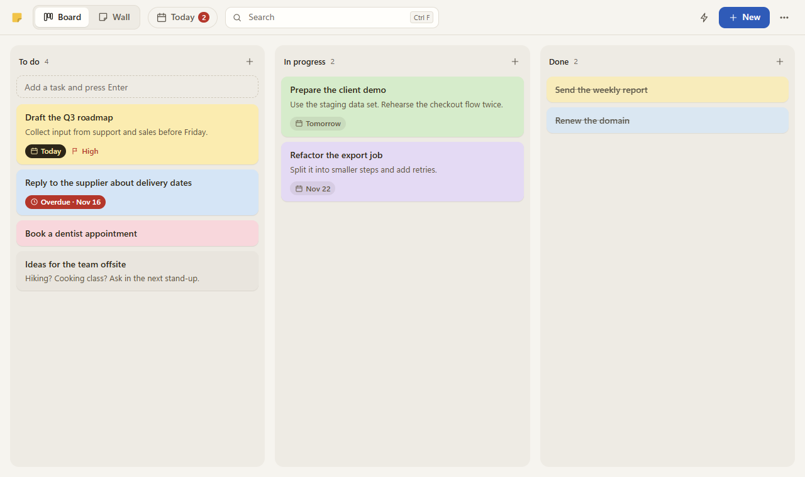
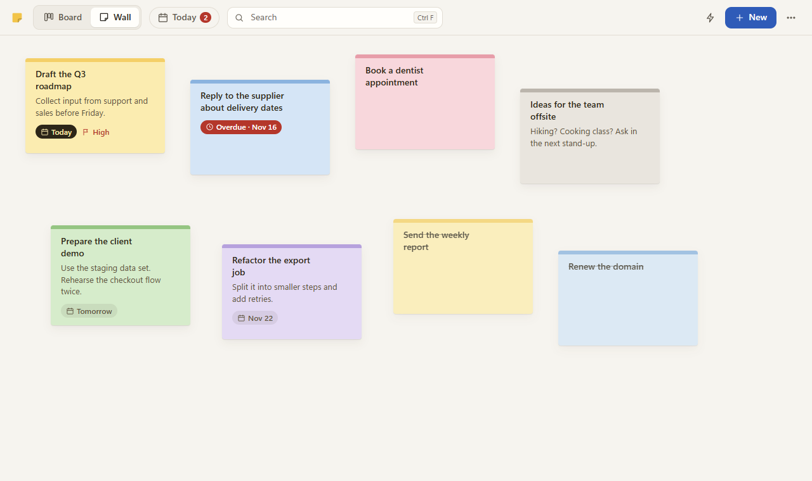
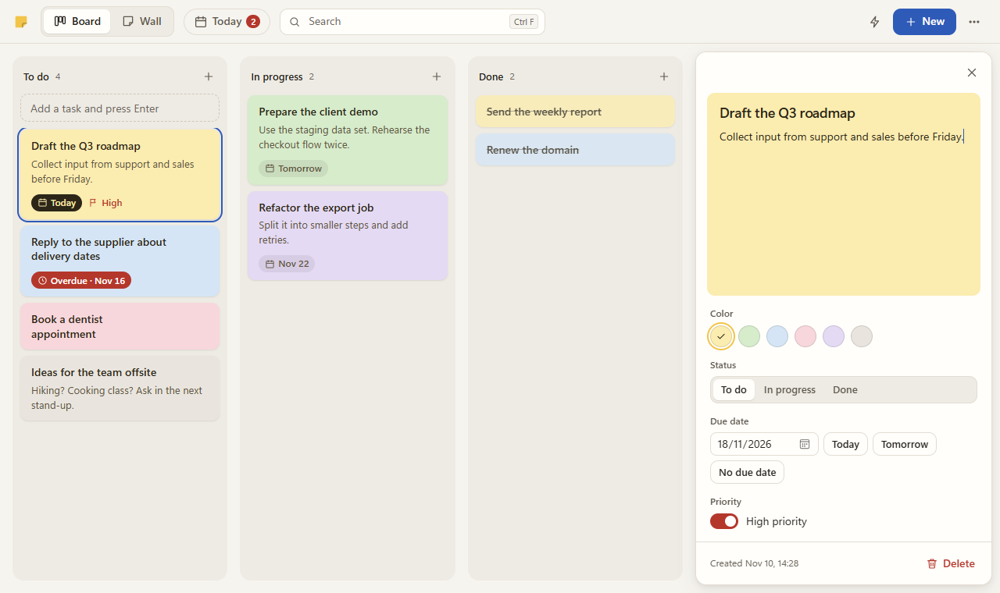
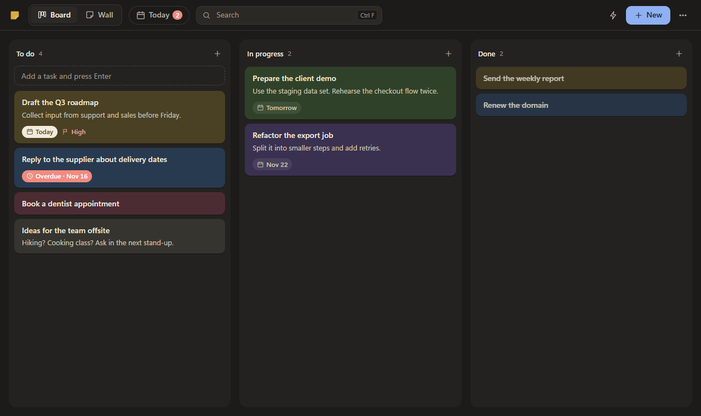
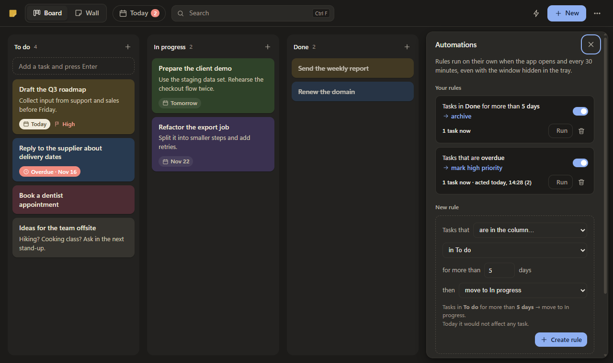

<p align="center">
  
</p>

<h1 align="center">NeverForget</h1>

<p align="center">
  Sticky notes, a Kanban board and simple automations for your daily tasks.<br>
  A small, offline Windows app that lives in the system tray.
</p>

<p align="center">
  <a href="LICENSE"></a>
  
  
  <a href="README.pt-BR.md"></a>
</p>



## Why

Most task apps want an account, a subscription and a browser tab. NeverForget is the opposite: a native window you summon with a hotkey, notes stored in a single SQLite file on your machine, and nothing leaving it. It is built for the small, recurring things that otherwise end up on paper stickers around the monitor.

## Features

- **Board**: three columns (To do, In progress, Done). Drag cards between columns or reorder them.
- **Wall**: the same notes as free-floating sticky notes you can place anywhere. Double-click an empty spot to add one there.
- **Inline editor**: title, details, color, status, due date and priority, saved as you type.
- **Today filter**: only what is due today or overdue, with a counter in the top bar.
- **Automations**: rules such as *"tasks in Done for more than 5 days → archive"*, with a live preview of how many tasks a rule would affect.
- **Archive**: archived notes leave the board but can be restored at any time.
- **Tray app**: closing the window only hides it; `Ctrl+Alt+N` brings it back from anywhere. Optional start with Windows.
- **English and Portuguese**, following the Windows language (switchable in the `⋯` menu).
- **Light and dark** themes: follows Windows by default, or pick one in the **⋯** menu. Responsive layout down to narrow windows.
- **Offline and private**: no account, no telemetry; the app itself makes no network requests.

| Wall | Editor |
|---|---|
|  |  |

| Dark theme | Automations |
|---|---|
|  |  |

## Install

Requirements: Windows 10 or 11 (64-bit) with the [WebView2 Runtime](https://developer.microsoft.com/microsoft-edge/webview2/), which ships with Windows 11 and current Windows 10 builds. No SDK, Visual Studio or admin rights needed.

```bat
git clone https://github.com/<your-user>/neverforget.git
cd neverforget
install.cmd
```

`install.cmd` builds the app (downloading the WebView2 SDK DLLs from NuGet on the first run), copies it to `%LOCALAPPDATA%\Programs\NeverForget`, creates Desktop and Start Menu shortcuts and starts it.

To remove it, run `uninstall.cmd` (keeps your notes) or `uninstall.cmd /purge` (also deletes them).

| Path | Content |
|---|---|
| `%LOCALAPPDATA%\Programs\NeverForget` | Program files |
| `%LOCALAPPDATA%\NeverForget\neverforget.db` | Your notes (copy this file to back up) |
| `%LOCALAPPDATA%\NeverForget\errors.log` | Error log, if anything went wrong |

## Usage

| Key | Action |
|---|---|
| `Ctrl+Alt+N` | Show the app from anywhere (press again for a new note) |
| `N` | New note |
| `1` / `2` | Board / Wall |
| `H` | Today filter |
| `A` | Automations |
| `Ctrl+F` or `/` | Search |
| `Esc` | Close the side panel |
| `Enter` / `Delete` on a focused card | Open / delete |

Command-line switches: `--tray` (start hidden), `--quit` (ask the running instance to exit), `--install` / `--uninstall` (create / remove shortcuts), `--dev` (enable DevTools).

### Automations

A rule is a condition plus an action, optionally limited to one column.

| Condition | Matches tasks… |
|---|---|
| In column for N days | that entered their current column more than N days ago |
| Unchanged for N days | not edited for more than N days |
| Overdue | whose due date passed (more than N days ago; 0 = any) |
| Due soon | due within the next N days, including overdue ones |

Actions: move to a column, archive, mark high priority, change color.

Rules run when the app starts and every 30 minutes while it is running, including when it is hidden in the tray. They do not run while the app is closed; it catches up the next time it opens.

## Development

```text
src/
  App.cs          WinForms host: window, tray icon, hotkey, single instance, WebView2 bridge, rule timer
  Store.cs        commands from the UI: CRUD, ordering, archive, automation engine, input validation
  Db.cs           minimal SQLite wrapper over the system winsqlite3.dll, schema and migrations
  Shortcuts.cs    .lnk files (Desktop, Start Menu, Startup) through the Shell API
web/
  index.html      markup, Content-Security-Policy
  app.css         design tokens, light/dark themes, responsive layout
  i18n.js         English and Portuguese strings
  app.js          UI logic (vanilla JS, no framework, no build step) and a localStorage mock
tools/
  fetch-webview2.ps1   downloads and verifies the WebView2 SDK DLLs
  make-icon.ps1        draws assets/neverforget.ico
  screenshots/         regenerates docs/screenshots from demo data
```

- `build.cmd` compiles with `csc.exe` from .NET Framework 4.x, which is part of Windows.
- The UI talks to the host through WebView2 `postMessage` with a tiny `{ id, cmd, args }` protocol. Every command is validated in `Store.cs`.
- Data lives in SQLite through `winsqlite3.dll`, the SQLite build that ships with Windows, so there is no native SQLite to bundle.
- Card order uses fractional positions: moving a card updates a single row.

**Working on the UI without the app**: serve the `web` folder and open it in a browser. It then uses a `localStorage` mock instead of SQLite; add `?demo` to load sample data (`?demo&lang=pt&view=wall` also works).

```bat
python -m http.server 5179 --directory web
```

**Screenshots**: `tools\screenshots\make.cmd` renders the demo data in WebView2 and rewrites `docs/screenshots/*.png`.

The automation logic exists twice, in `src/Store.cs` (real) and in `web/app.js` (`mockApply`, for the browser preview). Keep them in sync.

## Security and privacy

- No network requests from the app: the UI is served from the local `web` folder through a reserved `.example` host name, a strict Content-Security-Policy forbids remote content, SmartScreen lookups are off, and navigation, new windows, downloads and permission requests are all blocked. (The WebView2 runtime itself is updated by Windows, independently of the app.)
- The native bridge only accepts messages from the app's own page, accepts a fixed list of commands and validates every value. All SQL uses bound parameters.
- User text is always rendered as text, never as HTML.
- Native DLLs are loaded from `System32` only. The WebView2 SDK is downloaded from NuGet at a pinned version and checked against a SHA-256 hash and Microsoft's signature; the signature is re-checked on every build.
- Runs as a normal user, with no elevation, services, scheduled tasks or registry changes. "Start with Windows" is opt-in and is a visible shortcut in the Startup folder.
- The executable is not code-signed. Strict endpoint-protection setups may ask you to allow it.

See [SECURITY.md](SECURITY.md) to report a vulnerability.

## Limitations

- Windows only (WinForms, WebView2, winsqlite3).
- Rules based on "unchanged for N days" use the last edit time, so any edit, even a color change, resets the counter.
- Automation actions have no undo; only archiving can be reverted from the Archive panel.
- No sync between computers: back up `neverforget.db` yourself.

## License

[MIT](LICENSE). The WebView2 SDK is downloaded from NuGet at build time and is covered by Microsoft's own license.
