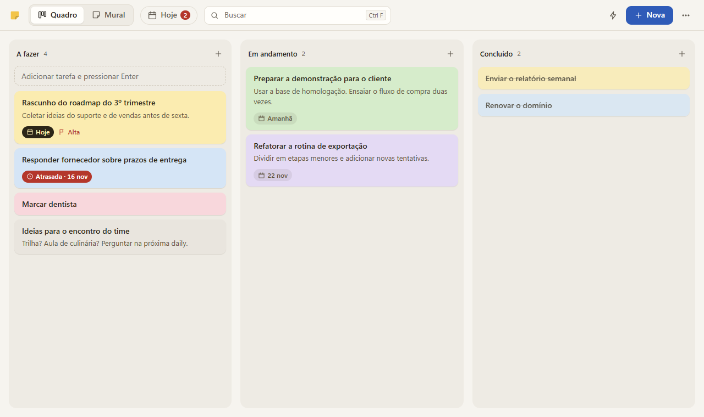

<p align="center">
  
</p>

<h1 align="center">NeverForget</h1>

<p align="center">
  Notas autoadesivas, quadro Kanban e automações simples para as tarefas do dia.<br>
  Um app pequeno para Windows, sem internet, que fica na bandeja do sistema.
</p>

<p align="center">
  <a href="LICENSE"></a>
  
  <a href="README.md"></a>
</p>



## Por quê

A maioria dos apps de tarefas pede conta, assinatura e uma aba no navegador. O NeverForget é o contrário: uma janela nativa que você chama com um atalho, notas guardadas num único arquivo SQLite no seu computador e nada saindo dele. Feito para as pequenas tarefas recorrentes que costumam virar papeizinhos colados no monitor.

## Recursos

- **Quadro**: três colunas (A fazer, Em andamento, Concluído). Arraste os cartões entre colunas ou para mudar a ordem.
- **Mural**: as mesmas notas como post-its soltos. Clique duas vezes num espaço vazio para colar uma nota ali.
- **Editor lateral**: título, texto, cor, situação, prazo e prioridade, salvos enquanto você digita.
- **Filtro Hoje**: só o que vence hoje ou está atrasado, com contador na barra superior.
- **Automações**: regras como *"tarefas em Concluído há mais de 5 dias → arquivar"*, com prévia de quantas tarefas a regra afetaria.
- **Arquivadas**: notas arquivadas saem do quadro, mas podem ser restauradas.
- **Bandeja**: fechar a janela só a esconde; `Ctrl+Alt+N` traz de volta de qualquer lugar. Iniciar com o Windows é opcional.
- **Inglês e português**, seguindo o idioma do Windows (dá para trocar no menu `⋯`).
- Temas **claro e escuro** conforme o Windows e layout responsivo.
- **Sem internet e privado**: sem conta, sem telemetria; o app não faz nenhuma requisição de rede.

As capturas de tela em inglês estão no [README em inglês](README.md).

## Instalação

Requisitos: Windows 10 ou 11 (64 bits) com o [WebView2 Runtime](https://developer.microsoft.com/microsoft-edge/webview2/), que já vem no Windows 11 e nas versões atuais do Windows 10. Não precisa de SDK, Visual Studio nem administrador.

```bat
git clone https://github.com/<seu-usuario>/neverforget.git
cd neverforget
install.cmd
```

O `install.cmd` compila o app (baixando as DLLs do SDK do WebView2 do NuGet na primeira vez), copia para `%LOCALAPPDATA%\Programs\NeverForget`, cria atalhos na Área de Trabalho e no Menu Iniciar e abre o app.

Para remover: `uninstall.cmd` (mantém suas notas) ou `uninstall.cmd /purge` (apaga também as notas).

| Caminho | Conteúdo |
|---|---|
| `%LOCALAPPDATA%\Programs\NeverForget` | Programa |
| `%LOCALAPPDATA%\NeverForget\neverforget.db` | Suas notas (copie este arquivo para fazer backup) |
| `%LOCALAPPDATA%\NeverForget\errors.log` | Registro de erros, se houver |

## Uso

| Tecla | Ação |
|---|---|
| `Ctrl+Alt+N` | Abrir o app de qualquer lugar (de novo: nova nota) |
| `N` | Nova nota |
| `1` / `2` | Quadro / Mural |
| `H` | Filtro Hoje |
| `A` | Automações |
| `Ctrl+F` ou `/` | Buscar |
| `Esc` | Fechar o painel lateral |
| `Enter` / `Delete` num cartão | Abrir / excluir |

### Automações

Uma regra é uma condição mais uma ação, que pode ser limitada a uma coluna.

| Condição | Pega tarefas… |
|---|---|
| Na coluna há N dias | que entraram na coluna atual há mais de N dias |
| Sem alterações há N dias | não editadas há mais de N dias |
| Prazo vencido | com prazo vencido (há mais de N dias; 0 = qualquer) |
| Vence em breve | que vencem nos próximos N dias, incluindo as vencidas |

Ações: mover para uma coluna, arquivar, marcar alta prioridade, mudar a cor.

As regras rodam ao abrir o app e a cada 30 minutos enquanto ele estiver aberto, inclusive escondido na bandeja. Com o app fechado elas não rodam; na próxima abertura ele executa todas.

## Desenvolvimento, segurança e limitações

Veja as seções *Development*, *Security and privacy* e *Limitations* do [README em inglês](README.md), e o [SECURITY.md](SECURITY.md) para relatar uma vulnerabilidade.

## Licença

[MIT](LICENSE). O SDK do WebView2 é baixado do NuGet na compilação e segue a licença própria da Microsoft.
